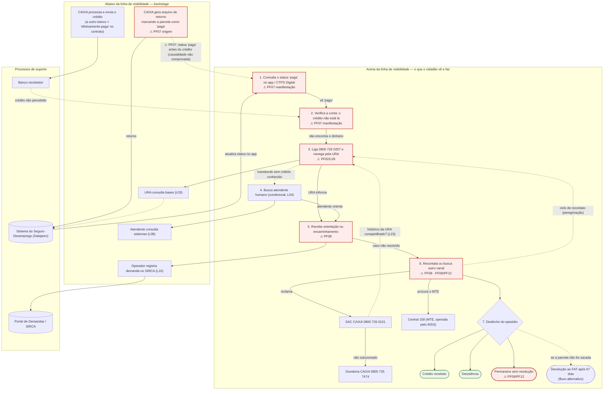

# Diagrama AS-IS — Atendimento ao Seguro-Desemprego pela URA da CAIXA

**Aluna:** Flavia Rios · **Exercício 3.1** · Jornada de referência: **"o status indica parcela paga, mas o dinheiro não está na conta"**.
Os nós correspondem às etapas, camadas e fail points decididos na entrevista (`C_grill_transcript.md`) e registrados em `C_blueprint_asis.md`.

**Convenções (Rodadas 4, 6 e 7):** setas contínuas indicam fluxos documentados (F); setas tracejadas indicam relações hipotéticas ou não integralmente comprovadas (H/L); ⚠ marca um fail point.

## Leitura do diagrama

- **Fluxo principal:** as etapas 1 a 7 do blueprint, da identificação do "paga" sem crédito até o desfecho.
- **Ciclo de recontato (Rodada 7):** a seta tracejada da etapa 6 de volta à etapa 3 representa a peregrinação. As ramificações para o SAC, a Ouvidoria e o 158 aparecem **sem transferência automática** do caso.
- **PF07 (Rodadas 4 e 7):** a seta tracejada do arquivo de retorno (backstage) até a etapa 1 **cruza a linha de visibilidade**, ligando a origem à manifestação da falha.
- **Quatro desfechos (Rodada 7):** crédito recebido, desistência, permanência sem resolução e devolução ao FAT. A devolução ao FAT é um fluxo alternativo, condicionado à regra dos 67 dias.
- **Lacunas visíveis:** L03, L04, L08, L10 e L23 estão nos rótulos e nos nós. São pontos de validação, e não fatos.
